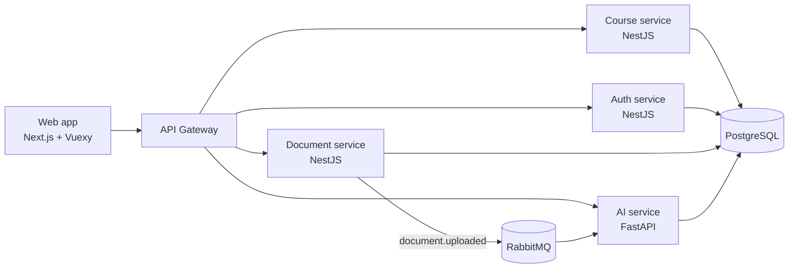

# Savio

**Savio** is a study platform for students. A student creates a space for each course, uploads their course material (PDF notes, slides), and can then ask questions about it and get answers with links back to the source pages, or generate summaries to review faster.

It is designed for **francophone and bilingual students in Canada**, with French and English supported from the start.

> 🚧 **Status: in active development.** Savio is being built as a microservices platform, one service at a time. The course service is working today; the other services are being added in this repository.

---

## Architecture

Savio is split into small services. Each one owns its own data and one area of the app, and they talk to each other through REST (for things the user waits for) and events (for background work).



| Service                                          | Responsibility                                           | Tech                            | Status                  |
| ------------------------------------------------ | -------------------------------------------------------- | ------------------------------- | ----------------------- |
| [`savio-course-service`](./savio-course-service) | Create, list, update and delete courses                  | NestJS, Drizzle ORM, PostgreSQL | ✅ In progress, working |
| Auth service                                     | Sign-up, login, profiles, JWT                            | NestJS                          | 🔜 Planned              |
| Document service                                 | File uploads, storage, processing status                 | NestJS, S3 / MinIO              | 🔜 Planned              |
| AI service                                       | Text extraction, embeddings, Q&A with sources, summaries | Python, FastAPI, pgvector       | 🔜 Planned              |
| API Gateway                                      | Single entry point, routing, JWT check, rate limiting    | —                               | 🔜 Planned              |
| Web app                                          | Student dashboard and course pages                       | Next.js, TypeScript, Vuexy      | 🔜 Planned              |

**Design principles**

- Each service has its own database schema; no service reads another service's tables.
- Long tasks (processing an uploaded PDF) run in the background through events, not inside a user request.
- Every service runs in Docker, so the whole platform can start locally with Docker Compose.

---

## Repository structure

```
savio-platform/
└── savio-course-service/   # Course management API (NestJS + PostgreSQL)
```

New services are added as sibling folders as they are built.

---

## Getting started

Each service has its own setup. To run the course service:

```bash
cd savio-course-service
npm install
docker compose up -d      # starts PostgreSQL
npm run start:dev         # API on http://localhost:3001
```

### Course service API

| Method   | Route          | Description                                                   |
| -------- | -------------- | ------------------------------------------------------------- |
| `GET`    | `/courses`     | List all courses (newest first)                               |
| `GET`    | `/courses/:id` | Get one course                                                |
| `POST`   | `/courses`     | Create a course (`name` required, `code` and `term` optional) |
| `PATCH`  | `/courses/:id` | Update a course                                               |
| `DELETE` | `/courses/:id` | Delete a course                                               |

Input is validated (unknown fields are rejected), and missing courses return `404`.

---

## Roadmap

- [x] Course API with validation
- [x] PostgreSQL with Docker Compose and Drizzle migrations
- [x] Full CRUD for courses
- [ ] Auth service and per-user courses
- [ ] Document upload service
- [ ] AI service: questions with cited sources, summaries
- [ ] Web app (Next.js + Vuexy)
- [ ] API gateway and RabbitMQ events
- [x] CI with GitHub Actions for each service
- [ ] Beta with real students
